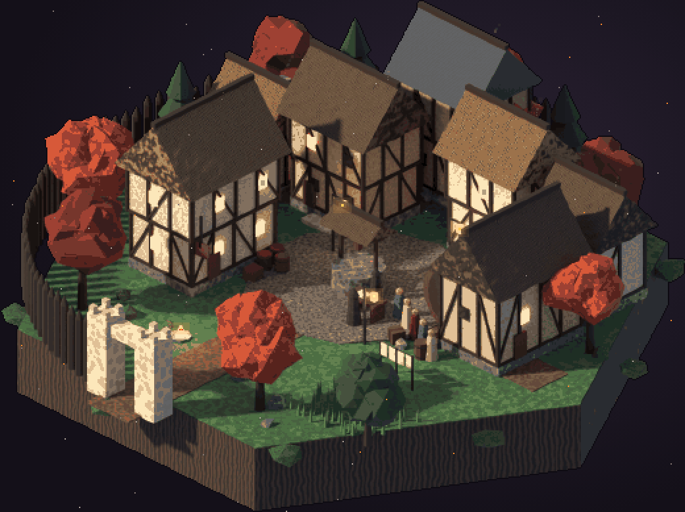

# Ashfall — Pixel

A 2D isometric pixel-art animated telling of **Kethric's adventure** from the *Ashfall* books.




## What's here

```
ashfall-pixel/
  map/index.html     the viewer: Kingdom / Greymark / Valencourt, Story + Buildings panels
  map/scene.html     detailed animated scenes (pre-rendered iso pixel art), e.g. Greymark square
  map/scenes/        rendered scene PNGs + overlay points (generated)
  tools/blender/greymark_diorama.py  builds Greymark square in 3D and renders it (Blender)
  tools/pixelize.py  render -> pixel art: downscale, 56-colour palette, outline, overlay points
  map/engine.js      pixel iso engine: terrain, gable-roofed buildings, walls, rifts, fire, smoke, ash
  map/world.js       the kingdom as data (places, regions, rivers, roads, Kethric's route)
  map/story.js       generated from data/story.json
  map/cities/*.js    baked city grids (generated)
  data/story.json    60 story events from book 3.0 (v2.45 differences as reference) + 35 named buildings
  cities/*.mfcg.json raw city layouts from the Medieval Fantasy City Generator
  tools/fetch_cities.mjs  pull city layouts from the generator (headless)
  tools/bake_city.py      city layout -> tile grid, building types, story-building placement
  tools/render.mjs        screenshots + animated GIF into out/
  docs/TOOLS.md      toolchain + city-planner research
  docs/WORLD.md      geography from the books, guesses flagged, open questions
```

## Run it

Open `map/index.html` in a browser. There is nothing to install.

- **Kingdom / Greymark / Valencourt** switch views. Drag to pan, and use the wheel or **+/−** to zoom.
- **Story 3.0** lists all 60 events in order. Clicking one jumps to where it happens, in the kingdom or inside a city.
- **Buildings**: in a city view you get the story buildings first (gold = key: the plot cannot happen without it), then every building by type. Click a type to highlight them all.
- **v2.45 ref** shows the older draft's places and notes as reference only. The story always follows 3.0.
- URL options: `?view=greymark`, `?ev=9`, `?type=tavern`, `?sel=cat:vex_mill`, `?z=3`, `?labels=0`, `?t=12`.

**Detailed scenes (Ultima Online-style pre-rendered pixel art):** install Blender's Python module (`python3.11 -m venv bvenv && bvenv/bin/pip install bpy`), then
`bvenv/bin/python tools/blender/greymark_diorama.py render.png --size 1500 --samples 40` and `python3 tools/pixelize.py render.png map/scenes/greymark-square.png --width 520 --colors 56`. Open `map/scene.html`.

To rebuild everything: `node tools/fetch_cities.mjs` (only to reroll layouts), then `python3 tools/bake_city.py`, then `node tools/render.mjs`.

## Edit the world

- **Kingdom:** edit `map/world.js` (`at(E, S, {...})` compass offsets; north is up).
- **Events and buildings:** edit `data/story.json`, then re-run `bake_city.py`.
- **Where a story building sits in a city:** change its rule in `tools/bake_city.py` (`CONFIG[...]['story']`).

## Roadmap

1. **Map v1** (done): kingdom map with places from the beat sheets and the animated route.
1. **Map v2** (done): a kingdom map twice the size, Greymark and Valencourt city plans, the 3.0 event timeline and building types.
1. **Scene v1** (done): Greymark square as a pre-rendered pixel diorama (timber frames, thatch, the red well, Aldren's queue, the palisade and gate), animated.
2. **Art direction**: more scenes from the same Blender kit (the mill interior, Harren's cellar, the ruin and young rift); paint over hero props in Aseprite; optional asset packs and AI drafts (see docs/ART_DIRECTION.md).
3. **First diorama**: Greymark in the hexagon-diorama style of the reference, with the well, the mill, the Broken Compass and Harren's cellar.
4. **Characters**: Kethric, Vex and Aldren with idle, walk and talk in 4 directions.
5. **Story runtime**: Phaser 4, Tiled scenes and an Ink script for the prologue (the road, Ollen, the barn).
6. **Web export**: GitHub Pages or itch.io.

See `docs/TOOLS.md` for why these tools were chosen.
