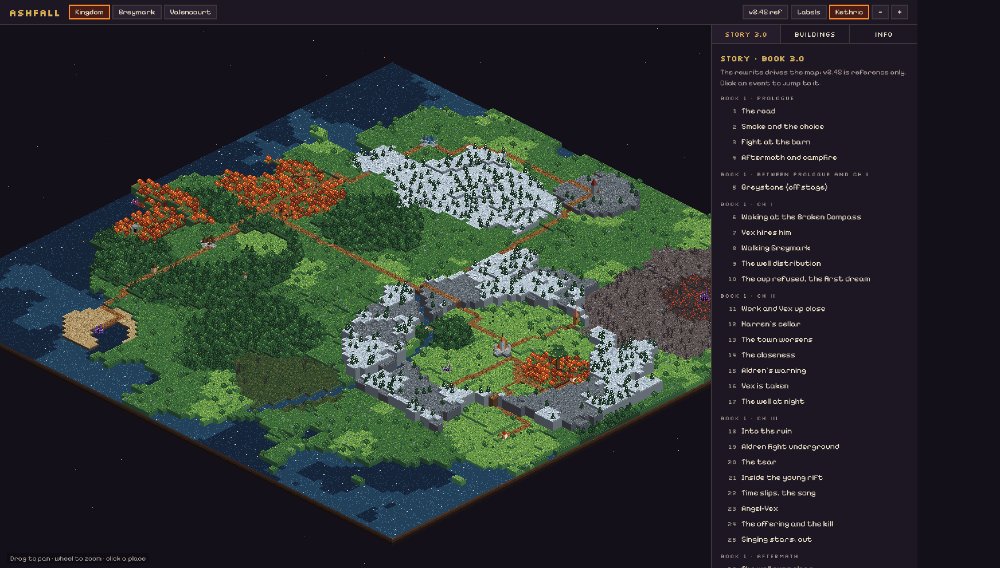

# Ashfall — Pixel

A 2D isometric pixel-art animated telling of **Kethric's adventure** from the *Ashfall* books.



## What's here

```
ashfall-pixel/
  map/            animated isometric kingdom map (open index.html in a browser)
    engine.js     tiny pixel iso engine: terrain blocks, sprites, buildings, rifts, fire, smoke, ash
    world.js      the kingdom as data: places, regions, rivers, roads, Kethric's route
    index.html    viewer: pan/zoom, labels, 3.0 / v2.45 layers, place cards
  tools/render.mjs  headless export -> out/kingdom.png, out/kingdom-245.png, out/kingdom.gif
  docs/TOOLS.md   toolchain research + recommended stack and pipeline
  docs/WORLD.md   geography pulled from the books, guesses flagged, open questions
  reference/      mood reference (the hexagon forest-camp diorama)
  out/            rendered images
```

## Run it

Open `map/index.html` directly in a browser. There is nothing to install.

- Drag to pan, and use the wheel or **+/−** to zoom. Click a place to read about it.
- **+ v2.45** adds places from the older draft (dashed labels).
- **Kethric** toggles the cloaked figure walking his route in story order.
- URL options: `?z=3` zoom, `?v=245` old layer, `?sel=greymark` select a place, `?labels=0`, `?t=12` freeze at a time.

To re-render the images, run `node tools/render.mjs` (it needs the Playwright, Chromium and ffmpeg that are already in this environment).

## Edit the world

Everything lives in `map/world.js`. Places use compass offsets `at(E, S, {...})` from the map centre, where north is the top of the screen. Each place has a `kind`, which picks its sprite:

`city town village church ruin well mill tavern orphanage keep vault camp rift gate battlefield bigtree marker`

## Roadmap

1. **Map v1** (done): kingdom map with places from the beat sheets and the animated route.
2. **Art direction**: lock the palette (Resurrect 64), then redo the terrain and props as Aseprite tiles at 32×16.
3. **First diorama**: Greymark in the hexagon-diorama style of the reference, with the well, the mill, the Broken Compass and Harren's cellar.
4. **Characters**: Kethric, Vex and Aldren with idle, walk and talk in 4 directions.
5. **Story runtime**: Phaser 4, Tiled scenes and an Ink script for the prologue (the road, Ollen, the barn).
6. **Web export**: GitHub Pages or itch.io.

See `docs/TOOLS.md` for why these tools were chosen.
