# Ashfall · Sprite cast

Every character as a high-res sprite and a low-res game sprite. Generated on the ChatGPT plan (prompts in `data/art_prompts.json`), cut out and laid out by `tools/build_cast.py`.

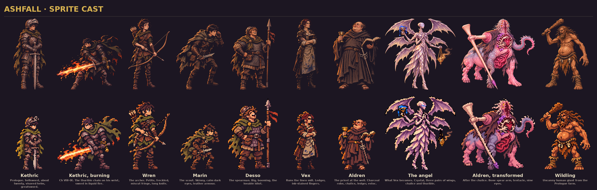

| | High-res | Low-res (×4) |
|---|---|---|
| **Kethric** Prologue. Sellsword, about twenty, visored helm, greatsword. | 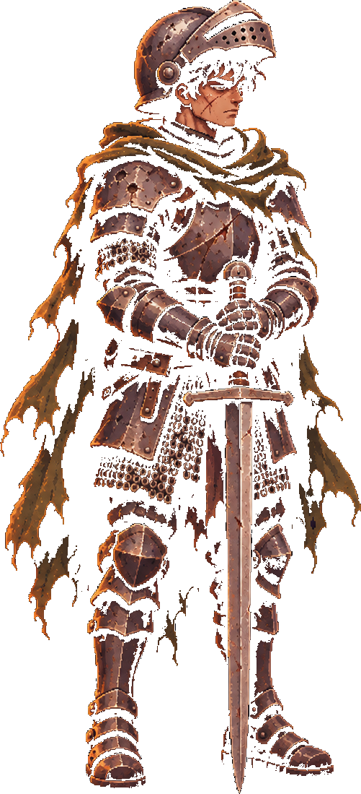 | 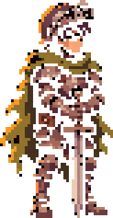 |
| **Kethric, burning** Ch VIII–IX. The thurible chain on his wrist, sword in liquid fire. | 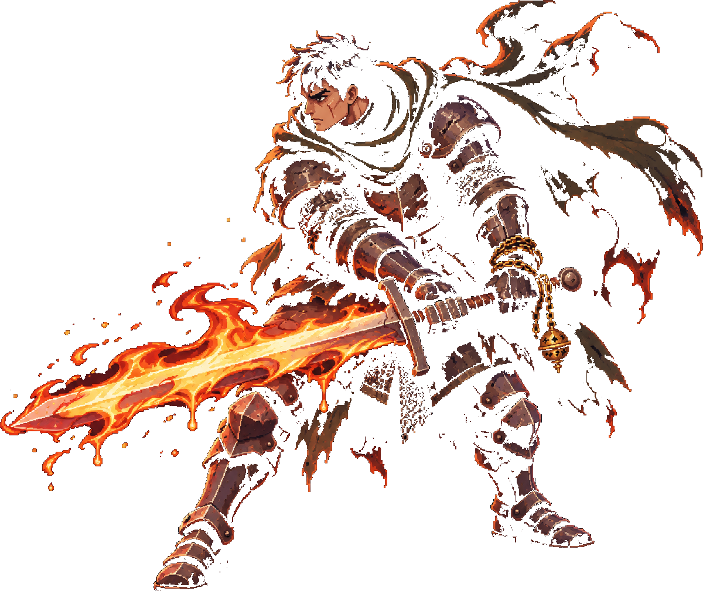 | 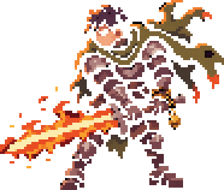 |
| **Wren** The archer. Petite, freckled, miscut fringe, long knife. | 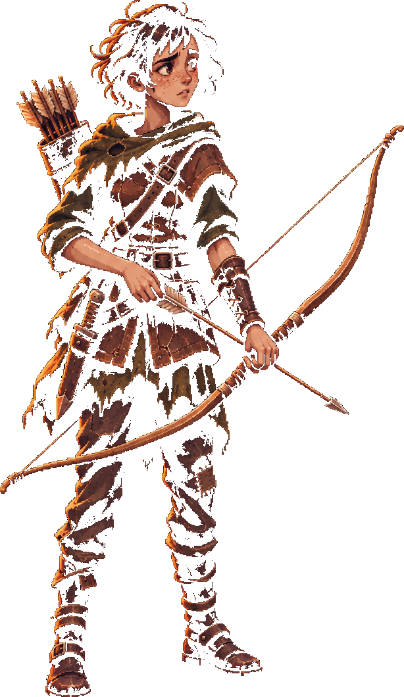 | 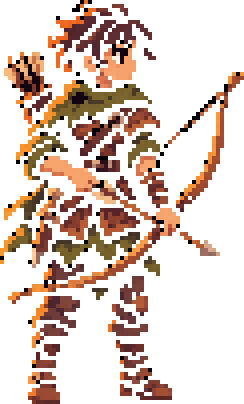 |
| **Marin** The scout. Skinny, calm dark eyes, leather armour. | 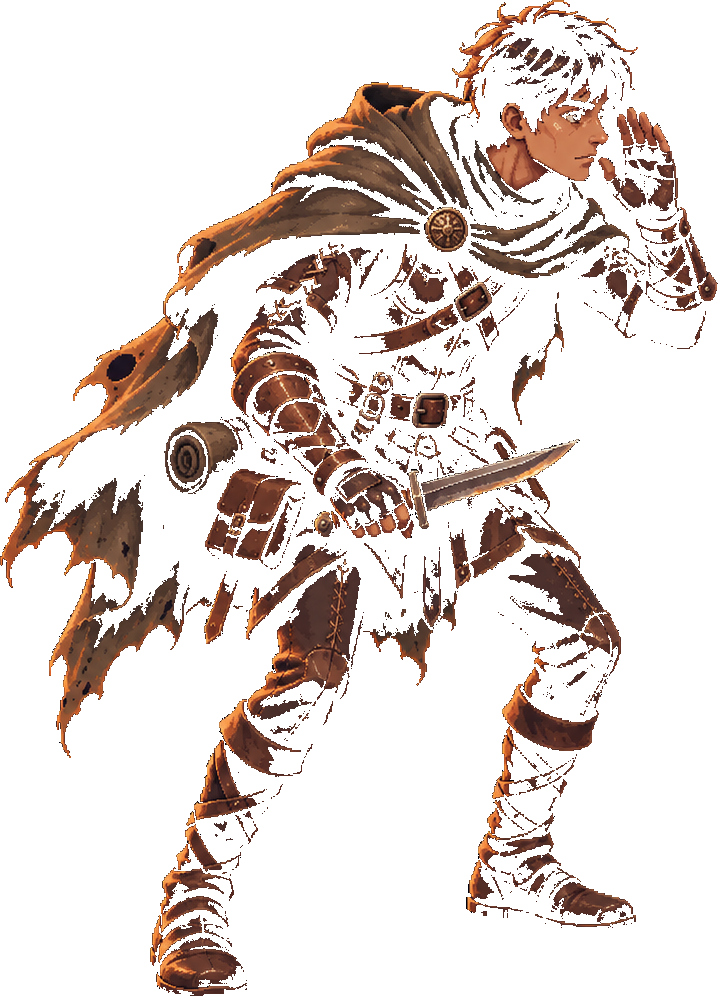 | 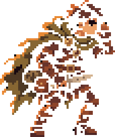 |
| **Desso** The spearman. Big, booming, the lovable idiot. | 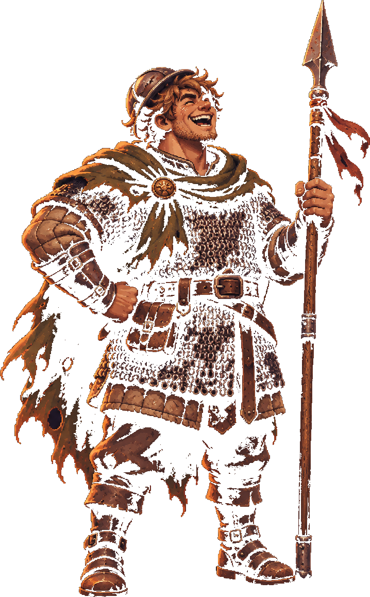 | 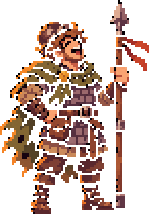 |
| **Vex** Runs the linen mill. Ledger, ink-stained fingers. | 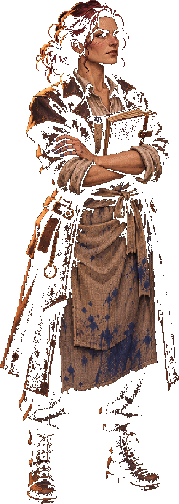 | 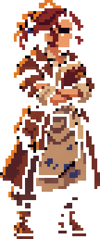 |
| **Aldren** The priest at the well. Charcoal robe, chalice, ledger, estoc. | 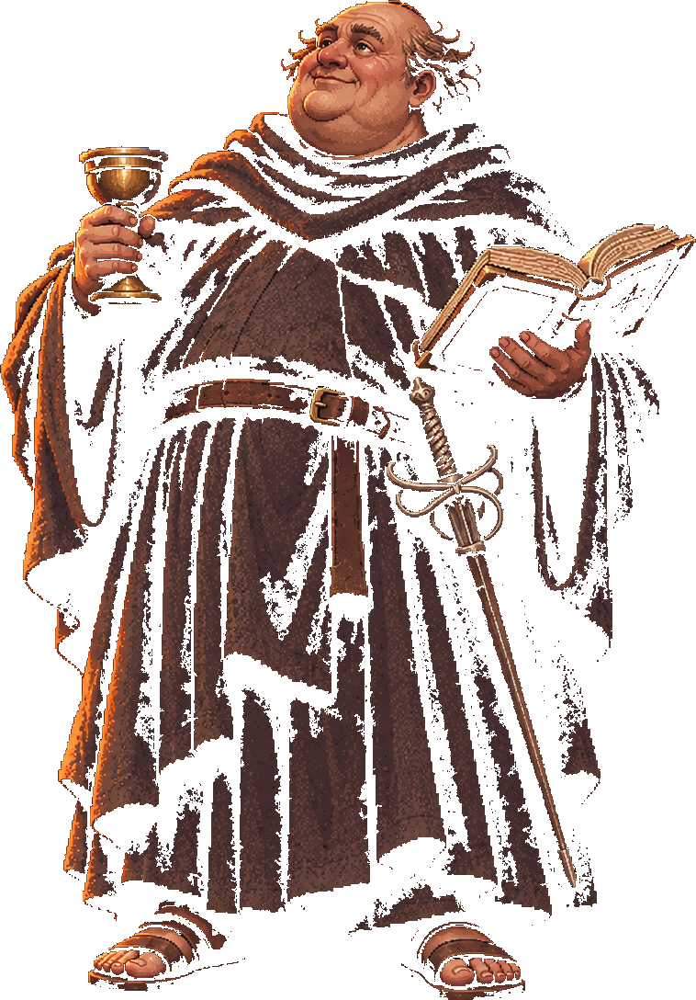 | 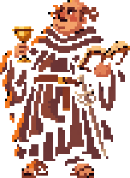 |
| **The angel** What Vex becomes. Crystal, three pairs of wings, chalice and thurible. | 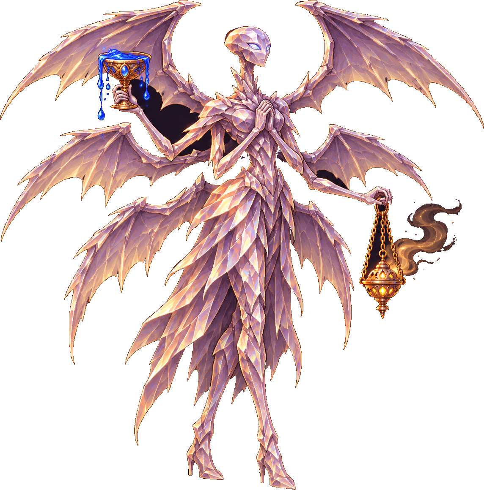 | 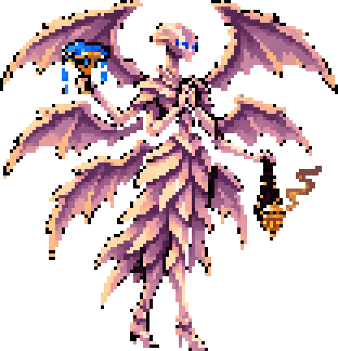 |
| **Aldren, transformed** After the chalice. Bone spear arm, tentacle, nine eyes. | 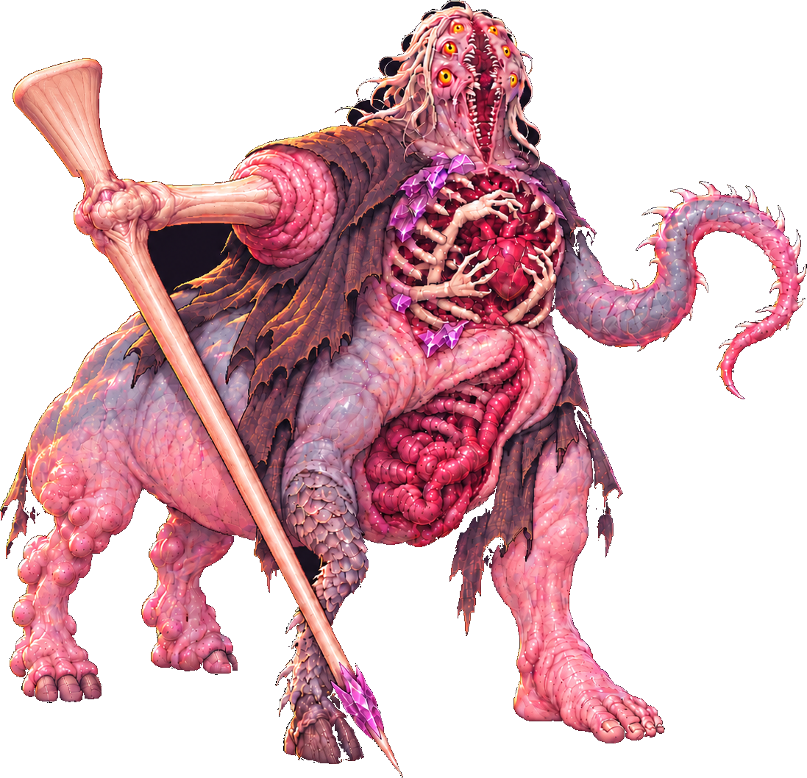 | 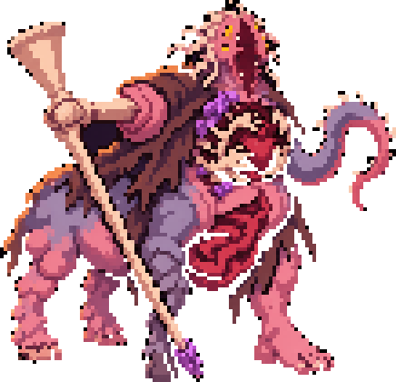 |
| **Wildling** Uncanny human giant from the Prologue farm. | 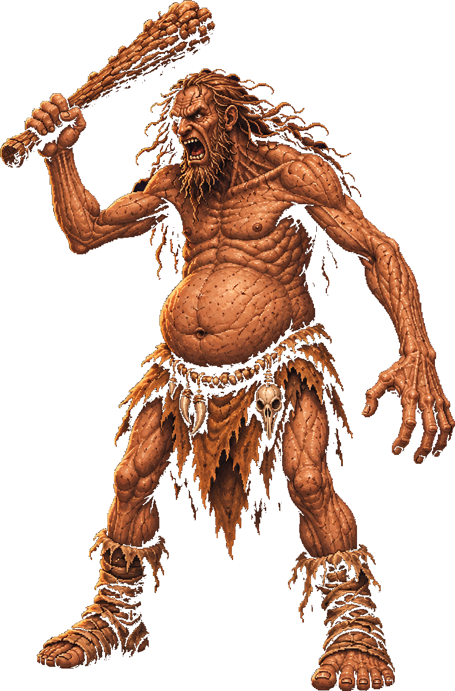 | 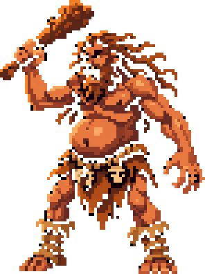 |

Low-res files: `cast/<id>_px.png` is native size (one art pixel per image pixel) for the game engine; `cast/<id>_px4.png` is the same scaled ×4 for viewing.
